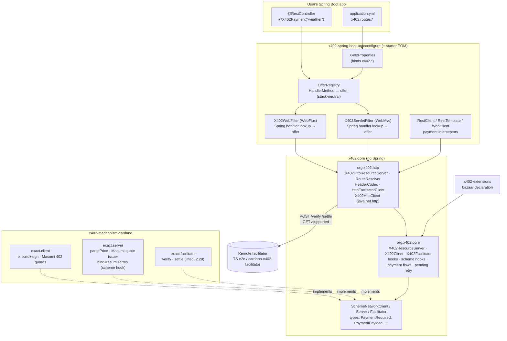

# Java SDK v2 + Spring Boot Starter — Implementation Plan

**Tier:** R2 overall (new public API, module boundaries, request-path concurrency). **WP7 and WP8 are R3** because they decide whether funds move and they sign them away.
**Branch:** `feat/java-v2-spring-starter` · **Plan base:** `f8f83309`
**Prior work:** spike 2026-10-08 (vault `30-Sessions/2026-10-08-java-sdk-v2-cardano-revival-spike.md`), dashboard https://claude.ai/artifact/M4CeCAB9QgHWzMzrHeCCiR
**Spec review:** APPROVED in round 10 (accounts), then Codex configuration review: 4 rounds, SOUND (2026-10-12); round 11 (route syntax, TS-shaped price) Codex SOUND after 3 more rounds; round 12 (facilitator list, Go/Python identifier) Codex SOUND after 3 rounds; round 13 (client hooks) Codex SOUND after 4 rounds; round 14 (facilitator guide) Codex rounds 15–16 fixed; previously APPROVED in round 8 (the earlier approval was round 6; rounds 4–7 extended the plan at the user's request). Round 3 approved the base plan; round 4 (Roles section + WP12) found 6 blockers, fixed in round 5; round 5 found 1 blocker, fixed in round 6. See the [Revision log](#revision-log).

## Goal

| | |
|---|---|
| **Goal** | Implement a v2 Java SDK (x402 protocol v2). Its headline feature is a Spring Boot 3 starter (WebMvc + WebFlux): `@X402Payment("<offer>")` on existing controller methods, with every offer and price defined in `application.yml`. Core, mechanism and adapter layout mirrors Go, Python and TS. Cardano `exact` is the first mechanism. |
| **Acceptance** | See [Acceptance criteria](#acceptance-criteria). |
| **Non-goals** | EVM/SVM/other mechanisms (the SPI leaves room, nothing more). Spring Boot 2 / `javax`. MCP transport. Extensions other than the bazaar server declaration. Cardano paywall UI (SPI and static fallback only). A non-Spring servlet filter (v1 in `java/legacy` keeps its own). Rebuilding `cardano-x402-facilitator` on the SDK. Maven Central publishing. Changing the TS/Go/Python SDKs or the Cardano spec. |
| **Assumptions** | Maintainer sign-off on #1017 obtained (user, 2026-10-12). v1 moves to `java/legacy` like `go/legacy` and `python/legacy`. TS `@x402/cardano` 2.28.0 is the reference behaviour. The unmerged Go and Python Cardano ports are structural references only. |

## Execution model (decided: no commits, see `docs/decisions/001-checkpoint-commits.md`)

**Outcome 2026-10-12:** the first checkpoint commit was refused by the git-authority hook, so all packages run without commits. Red-first is shown manually (test run before its code exists, output logged in the package's `## Log`); scope is checked by hand against each package's allowed files. The text below is the original proposal.

`red-first.sh` and `check-scope.sh` compare against a commit. Your default is "leave work staged, never commit", so the plan base would stay at `f8f83309` forever. Every package from WP2 on would then fail scope (WP1's files show up as out-of-scope), and red-first could never establish a green baseline.

**Proposed:** one checkpoint commit per package on `feat/java-v2-spring-starter`, made after that package's verify and review pass. Never on `main`, never pushed. Each package's `Base:` is filled with `git rev-parse HEAD` when it starts.

- **Packages run one at a time in this working tree.** A package marked parallel in the order below may only run in parallel inside its own git worktree and branch (`superpowers:using-git-worktrees`). It is merged back before the next package takes its Base. Otherwise `check-scope.sh` sees the other package's files.
- **WP1 commits the plan docs and the skeleton of every v2 module.** Each skeleton is a pom, an empty main and one passing smoke test. Every later package then starts from a green baseline, and the root `<modules>` list never changes again, so parallel packages don't collide on `java/pom.xml`.
- **Without checkpoint commits,** each package records `red-first unverified: no checkpoint commits` and scope is checked by hand. That is weaker evidence, which is why I recommend the commits.

## Global constraints

- **Java 17 baseline** for every v2 module: Boot 3's minimum, and `java.yml` already uses JDK 17. Code lifted from `cardano-x402-facilitator` (Java 21) is down-ported.
- **Maven multi-module reactor** under `java/`. The v1 quality gates apply to every v2 module: checkstyle, spotbugs, and jacoco ≥ 85 % instruction / 75 % branch. CI keeps the explicit `checkstyle:check spotbugs:check` goals.
- **Core is framework-free.** No Spring imports outside `x402-spring-boot-*`, enforced by an ArchUnit test (WP2).
- **Wire parity over Java idiom.** Header names, base64-JSON encoding, field names, route-pattern semantics, status codes, timeouts and retry rules follow TS. Where SDKs diverge, TS wins and the Javadoc says so. For example, a malformed `PAYMENT-SIGNATURE` is treated as unpaid (402), not Go's 400.
- **No package overlap with v1.** v1 owns `org.x402.{client,model,server,crypto,util}`. v2 lives in `org.x402.core`, `org.x402.http`, `org.x402.mechanisms.cardano`, `org.x402.extensions` and `org.x402.spring`.
- **Every package's allowed files include `docs/**`,** so plan and STATUS updates never trip scope.
- **Tests are immutable once red-first is recorded.** Never commit to `main`, never push. End state: with checkpoint commits, the work sits as commits on the feature branch. If you want staged-only instead, the last step is `git reset --soft f8f83309`, done only with your OK.
- **Time is injected.** Every time-dependent check (TTL, Masumi deadline and horizon, confirmation wait) takes a `java.time.Clock`. Tests pin it.

---

## Summary

The Java SDK is still protocol v1: 18 classes, a single EVM `exact` servlet filter, no mechanism SPI, and no e2e presence. This plan moves v1 to `java/legacy` and builds a v2 Maven reactor with the same three layers as Go and TS:

- **`x402-core`** holds the wire types; the `SchemeNetwork{Client,Server,Facilitator}` SPI including scheme hooks; `X402Client`, `X402ResourceServer` and `X402Facilitator` with lifecycle hooks, payment flows and pending-settle retry; and a framework-agnostic HTTP layer (`X402HttpResourceServer`, route patterns, header codec, facilitator client, a `java.net.http` payment client).
- **`x402-mechanism-cardano`** holds Cardano `exact` client, server and facilitator. Facilitator verification is lifted from the user's `cardano-x402-facilitator` and brought from 2.26 to 2.28. Server-side Masumi terms binding and the client transaction builder are new.
- **All three roles are first-class:** resource server (provider), client (buyer) and facilitator. See [Roles: payment options, clients, facilitators](#roles-payment-options-clients-facilitators).
- **`x402-spring-boot-autoconfigure` and `x402-spring-boot-starter`** are what users touch. `@X402Payment("weather")` names an offer under `x402.routes.weather`, and offers with a `path:` are protected without any annotation. The offer is resolved from the handler Spring actually dispatches to, so matching cannot drift from routing. The YAML route map stays the source of truth, matching every other SDK.

Java servers and client then join the e2e harness on the Cardano routes.

## Diagram — module boundaries



New dependency edges (everything is new; these are the ones the build enforces):

```
x402-spring-boot-autoconfigure ──→ x402-core                    NEW
x402-spring-boot-autoconfigure ──→ x402-mechanism-cardano       NEW  optional, @ConditionalOnClass
x402-spring-boot-autoconfigure ──→ x402-extensions              NEW  optional, @ConditionalOnClass
x402-mechanism-cardano         ──→ x402-core                    NEW
x402-extensions                ──→ x402-core                    NEW
x402-core                      ──→ (jackson only)               ✓ ArchUnit: no org.springframework.*
x402-core                      ──→ x402-mechanism-*             ✗ forbidden (ArchUnit)
java/legacy                    ──→ (unchanged v1)               ✓
```

## Developer-facing contract (the API this plan commits to)

```java
@RestController
class WeatherController {
  @GetMapping("/weather")
  @X402Payment("weather")              // offer name → x402.routes.weather
  Weather weather() { ... }
}
```

```yaml
x402:
  enabled: true                        # default true when the starter is on the classpath
  facilitators:                        # a list, like TS/Go/Python; order = precedence for unpinned options (Roles §1b)
                                       # none configured → one entry https://x402.org/facilitator (TS/Go/Python default)
    - url: https://facilitator.example
      identifier: cardano              # optional (Go Identifier / Python identifier); defaults to the url; only needed to pin
      timeout: 90s                     # settle + /supported; TS/Go/Python default; must exceed the facilitator's 75 s confirmation wait
      verify-timeout: 15s              # /verify only (Java); bounds the extra hop when failover is on
      headers:                         # static auth headers per call (TS createAuthHeaders shape); an auth-ref bean overrides
        verify:    { Authorization: "Bearer ${FACILITATOR_TOKEN}" }
        settle:    { Authorization: "Bearer ${FACILITATOR_TOKEN}" }
        supported: { Authorization: "Bearer ${FACILITATOR_TOKEN}" }
    # second entry only when one facilitator can't serve every option, or as a verify backup:
    # - url: https://backup-facilitator.example
  sync:
    startup-timeout: 10s               # total budget for the synchronous /supported check at startup
  accounts:                            # where you get paid: one entry per (network, receiving address, transfer method) — Roles §1a
    preprod:                           # name matches [a-z0-9-]+; referenced by options (account: ...)
      network: cardano:preprod         # CAIP-2, required
      pay-to: addr_test1q...           # or pay-to-ref: <X402DynamicPayTo bean>
      cardano:
        l1-confirmations: 1            # → extra.confirmationPolicy; -1..20; omitted = TS default 1
    preprod-escrow:                    # same network, different transfer method and receiver
      network: cardano:preprod
      extra: { assetTransferMethod: masumi }
      # pay-to omitted → the escrow address derived for the canonical Masumi deployment (a set value must equal it)
      cardano:
        masumi:
          seller-mnemonic: ${SELLER_MNEMONIC}   # quote signing; a CardanoSellerSigner bean wins
    mainnet:
      network: cardano:mainnet
      pay-to: addr1...
      max-timeout-seconds: 600         # per-network override
    # base:                            # EVM is a later plan; shown for shape only
    #   network: eip155:8453
    #   pay-to: "0xabc…"
    #   facilitator: base              # pins every option on this account
  defaults:                            # network-independent only; per-network values live on accounts
    scheme: exact
    max-timeout-seconds: 300
    failover: false                    # verify-only, one hop; per offer overrides (Roles §1b)
    # facilitator: cardano             # optional pin; account and option override it
  routes:                              # one entry per offer; its payment options are always listed under accepts
    weather:                           # used by @X402Payment("weather")
      description: Weather API
      mime-type: application/json
      accepts:
        - { account: preprod, price: "$0.01" }   # "$" = the network's default stablecoin, 1:1: 0.01 USDM → amount 10000 (6 decimals)
    report:
      path: "GET /report/*"            # x402 route-pattern syntax (TS): *, :param, [param]; {var} is rejected
      description: Market report
      accepts:                         # several options: the buyer picks one; order = your preference
        - { account: preprod, price: "$0.50" }
        - { account: preprod, price: { amount: "1500000", asset: lovelace } }   # 1.5 ADA in atomic units (TS AssetAmount)
        - { account: mainnet, price: "0.50 USDM" }                              # ticker form, same as "$0.50"
        - network: "cardano:mainnet"   # inline option without an account (TS shape): network + pay-to
          pay-to: addr1...partner
          price: "$0.60"
      extensions:
        bazaar: { discoverable: true }
    escrow-job:
      accepts:
        - { account: preprod-escrow, price: "$5" }          # Masumi escrow; payTo = the derived escrow address
    dynamic:
      accepts:
        - { account: preprod, price-ref: tieredPricer }     # bean name of an X402DynamicPrice; resolved per request
  paywall:
    enabled: true                      # browser 402s get HTML; static fallback for now
  client:                              # RestClient/WebClient interceptor (optional)
    enabled: false
```

**Binding shape:**
- `price` is a money string or an object `{amount, asset, extra}`, exactly TS `Price = Money | AssetAmount` (`core/src/types/index.ts:64-70`).
  - Money strings follow TS `parseMoney` (`core/src/utils/index.ts:62-82`): `"$0.50"`, `"0.50"`, `"0.50 USD"` and `"0.50 USDM"`. `$` means the network's default stablecoin at 1:1, with no exchange rate (USDM on Cardano, `defaultAssets.ts`).
  - Both forms bind to one typed `PriceSpec`: a `@ConfigurationPropertiesBinding` converter takes the string, and the binder takes the object.
  - **Overriding from the environment:** Spring replaces a whole list from a higher-priority source. An env var such as `X402_ROUTES_REPORT_ACCEPTS_0_PRICE` therefore replaces all of `accepts`, losing `account` and the other entries, and startup fails on the incomplete entry. Values meant to vary per environment go into YAML placeholders instead (`price: "${REPORT_PRICE:$0.50}"`, `pay-to: "${PREPROD_PAY_TO}"`), or the whole list goes into `SPRING_APPLICATION_JSON` or a profile YAML. The README says so; WP5 tests the placeholder form and the YAML-plus-env failure.
  - `price` and `price-ref` on one option → startup error.
  - There is no `"1.5 ADA"` sugar: TS throws on it, because ADA is not a default asset. ADA prices are written in lovelace.
- `extra` is `Map<String, Object>`.
- `facilitators` is a `List` (TS/Go/Python shape). `accounts` is a `LinkedHashMap` keyed by `[a-z0-9-]+` names, because options reference accounts by name; CAIP-2 ids are values (`network:`), never keys.
- Spring replaces a whole list from a higher-priority source. So per-environment facilitator values go into placeholders (`url: "${FACILITATOR_URL}"`), not `X402_FACILITATORS_0_URL`.
- Inside inline YAML (`{…}`, `[…]`), `${…}` placeholders must be quoted: SnakeYAML rejects `{ pay-to: ${PAY_TO} }`. *(Corrected in WP11, decision 185: SnakeYAML 2.4, which Boot 3.5 ships, accepts an unquoted `{ network: cardano:preprod }`; the examples still quote CAIP-2 ids for YAML 1.1 parsers.)* All examples here parse; WP11 adds a test that loads every README YAML snippet.
- Every field has config metadata, so IDEs complete it. The processor emits nothing for the values of `Map<String, Pojo>` (`accounts.*`, `routes.*`) or for list elements (`facilitators[]`), so WP5 ships `additional-spring-configuration-metadata.json` for those (offer fields and `accepts[]` entries included).
- `extra` keys are case-sensitive protocol keys, but Spring lowercases map keys that come from environment variables. An `extra` key that equals a known protocol key case-insensitively but not exactly (e.g. `assettransfermethod`) → startup error. The README says to set `extra` from YAML or `SPRING_APPLICATION_JSON`, not from plain env vars; `l1-confirmations` and other typed fields are env-safe. No polymorphic `Object` fields.

**Rules the starter enforces**, each with a named test in WP5/WP6:

1. **Unknown offer.** `@X402Payment("x")` with no `x402.routes.x` fails startup. The error lists the known offers.
2. **Class vs method.** A class-level `@X402Payment` applies to every handler method. A method-level annotation overrides it.
3. **Matching follows dispatch.** The filter asks Spring's own handler mappings which handler wins, then looks up that `HandlerMethod`'s offer. A free, more specific handler (`/items/free` next to a paid `/items/{id}`) stays free.
   - CORS pre-flight requests are never charged.
   - HEAD on a paid GET handler is charged like GET, because Spring runs the handler.
4. **YAML `path:` routes.**
   - They match against Spring's path-within-application (context path removed, `;` path parameters stripped) and its decoded form, using the TS pattern semantics.
   - `{`/`}` in `path:` is a startup error.
   - A `path:` that matches no registered handler logs a startup warning.
   - If a request matches both an annotated handler and a `path:` route, the annotation wins, and the overlap is logged once at startup.
5. **Unused offer.** A YAML offer with neither `path` nor an annotation user produces a startup warning.
6. **Response handling (TS parity).**
   - The response is buffered.
   - Handler status ≥ 400, or an exception: the verified payment is cancelled (`onVerifiedPaymentCanceled` fires), failure-path `PAYMENT-RESPONSE` headers are set, `Settlement-Overrides` is stripped, and there is no settle.
   - Status < 400: settle (with one pending retry), then release the body.
   - Settle failure: 402 + `PAYMENT-RESPONSE`, handler body discarded.
   - Facilitator transport error: 502.
   - Upfront/escrow flows settle before the handler, as in TS.
7. **Streaming refused.** Paid handlers with streaming return types are refused at startup for `authorization` flows: `SseEmitter`, `ResponseBodyEmitter`, `StreamingResponseBody` (also inside `ResponseEntity`), `text/event-stream`, and streaming `Flux`.
8. **Customization through beans, not YAML:** `X402ResourceServerCustomizer` (register schemes and hooks), `X402DynamicPrice`, `X402DynamicPayTo`, `X402FacilitatorAuthProvider`, `PaywallProvider`, `CardanoSellerSigner`, `MasumiTermsStorage`.
   - Auto-configured beans back off when the user defines their own (`@ConditionalOnMissingBean`).
   - A scheme registered by a customizer replaces the auto-registered one for the same scheme + network.
9. **Facilitator sync and route validation at startup.** See [Roles §1b](#1b-facilitators-for-multi-option-offers) for the four cases (all facilitators answered, partial failure, lazy re-sync failure, no offers).

Two operational facts go in the README:
- A paid request can hold a servlet thread, or a `boundedElastic` worker, for up to 2 × verify-timeout + 2 × settle timeout, which is 210 s with defaults and verify failover on. That covers two verifies, one settle wait and one pending retry. Clients default to a 240 s timeout for this reason.
- The default `MasumiTermsStorage` is in-memory, which is only correct for a single instance. Multi-instance deployments must supply a shared, atomic store.

## Roles: payment options, clients, facilitators

### 1. API provider: several payment options

An **offer** is a list of payment options (`accepts`). One endpoint has one offer, and the offer can hold any number of options. This is TS `RouteConfig.accepts: PaymentOption[]`, which is how every SDK expresses choice.

| Option field | Varies per option | Default source |
|---|---|---|
| `account` | named account supplying the per-network fields below (§1a) | — (each entry names one, or is inline) |
| `scheme` | `exact` today; any registered scheme later | account, else `x402.defaults.scheme` |
| `network` | e.g. `cardano:preprod`, `cardano:mainnet` (later `eip155:8453`) | account (required there, or inline) |
| `price` | money string (`"$0.50"` = 0.50 USDM) or `{amount, asset}` (lovelace, any native token) | — (required, or `price-ref`) |
| `pay-to` / `pay-to-ref` | per network or per method (Masumi needs the escrow address) | account |
| `price-ref` | `X402DynamicPrice` bean evaluated per request | — |
| `max-timeout-seconds` | | account, else `x402.defaults.max-timeout-seconds` (300) |
| `extra` | e.g. `assetTransferMethod: default \| masumi \| script` | account `extra` merged under the option's |

```yaml
x402:
  accounts:
    preprod:        { network: "cardano:preprod", pay-to: addr_test1qseller... }
    preprod-escrow:
      network: cardano:preprod
      extra: { assetTransferMethod: masumi }
      cardano: { masumi: { seller-mnemonic: "${SELLER_MNEMONIC}" } }
    mainnet:        { network: "cardano:mainnet", pay-to-ref: mainnetTreasury }
  routes:
    report:
      description: Market report
      accepts:                                    # listed in the provider's order of preference
        - account: preprod                        # 1. USDM on preprod
          price: "$0.50"
        - account: preprod                        # 2. 1.5 ADA on preprod
          price: { amount: "1500000", asset: lovelace }
        - account: preprod-escrow                 # 3. USDM via Masumi escrow
          price: "$0.50"
        - account: mainnet                        # 4. mainnet, different wallet, dynamic price
          price-ref: reportPricer
```

Semantics (TS parity unless marked):
- **Order:** options keep their YAML order in `PAYMENT-REQUIRED.accepts`. The order states the provider's preference; the client decides (see 2).
- **Merge:** option → account → `defaults` → built-in, per field (§1a rule 3). Every offer lists its options under `accepts`, even a single one (§1a rule 2).
- **Dynamic values:** `price-ref` and `pay-to-ref` are resolved per request, per option.
- **Matching a payment:** the incoming `PaymentPayload.accepted` must match one of the built requirements. All requirement fields must be equal; the client may add `extra` fields, and dynamic extra fields are excluded (`x402ResourceServer.ts:1516-1557`). The first match wins.
- **Validation at initialize (TS parity, `x402HTTPResourceServer.ts:486-495`, `:1118-1228`):** every option needs a registered server scheme, a supported assetTransferMethod and paymentFlow, and a facilitator kind. `RouteConfigurationError` and `FacilitatorCapabilityError` are fatal. Lives in core (WP3/WP4), so it also applies without Spring.
- **Tiers on one endpoint** (free vs paid, or plan-based prices) do not use a second annotation. Use `price-ref`, or separate endpoints. One handler maps to exactly one offer.

#### 1a. Accounts: several networks, wallets and transfer methods

One `defaults` block cannot describe a seller who is paid on preprod and mainnet (and later Base), to different addresses, with Masumi escrow next to plain transfers. The values that differ per network belong to a named **account**; `defaults` keeps only what is network-independent.

**What the other SDKs do** (survey 2026-10-12, base `f8f83309`): none has a defaults block or a declarative config file.

| | TS | Go | Python | **Java (this plan)** |
|---|---|---|---|---|
| Per-network pay-to | constants in app code, one per network (`examples/typescript/servers/advanced/all_networks.ts:37-50`) | same (`examples/go/servers/gin/main.go:25-35`, used at `:72-85`) | same (`examples/python/servers/fastapi/main.py:49-77`) | named `x402.accounts` entries |
| Multi-network offer | an `accepts` array with one entry per network, each with explicit `network` + `payTo`; shared across routes via a variable (`all_networks.ts:105-240`) | `PaymentOptions` slice, explicit per entry | `accepts=[PaymentOption(...)]`, explicit per entry | `accepts` entries with `account:`, or inline `network` + `pay-to` (TS shape) |
| Pay-to per transfer method on one network | e2e picks address by method: plain, Masumi escrow, script (`e2e/src/mechanisms.ts:938-955`) | — | — | one account per method |
| Scheme registration | per network or pattern, `server.register("cardano:*", …)` | per network | per network | derived from the accounts in use; customizers override |
| Network-specific scheme config | in the scheme constructor; Masumi seller resolved **by network** (`masumiIssuer.ts:61-68`) | — | — | `accounts.<name>.cardano.*` |
| Confirmation policy | route `extra.confirmationPolicy` (`e2e/src/mechanisms.ts:925-936`) | — | — | `accounts.<name>.cardano.l1-confirmations` → `extra` |

Accounts are named, rather than keyed by CAIP-2 id, for two reasons:
- Spring strips `:` from map keys unless written `"[cardano:preprod]"`, which is easy to get wrong.
- One network often needs several accounts: plain transfer, Masumi escrow, script address.

**Account fields:** `network` (required), `pay-to` | `pay-to-ref`, `scheme`, `max-timeout-seconds`, `extra`, `facilitator` (pin), and a mechanism block (`cardano: { l1-confirmations, masumi: { seller-mnemonic, seller-return-address, agent-identifier, deployment } }`). The mechanism block is bound and consumed by WP13, not by core.

**Resolution rules** (tested in WP5 `OfferResolutionTest`, WP13 for the Cardano block):
1. **Which account.**
   - An `accepts` entry uses its `account:`. An entry with both `account:` and `network:` is a startup error: it would advertise one network's `pay-to` on another network.
   - Without `account:`, the entry is inline (TS-shaped): `network` is required, and no account is involved. `pay-to`/`pay-to-ref` is required too, except for a Masumi option, whose escrow address a contributor derives (rule 6); the post-contributor check in rule 5 enforces it either way.
   - An entry with neither `account` nor `network` → startup error.
2. **No shorthand.** Every offer lists its options under `accepts`, even a single one. Go requires a list; TS and Python accept one. An offer-level `price`, `price-ref` or `accounts` → startup error, with a hint to write an `accepts` entry.
3. **Field precedence** per option: option → account → `x402.defaults` → built-in (`scheme: exact`, `max-timeout-seconds: 300`). `extra` maps merge account → option only (`defaults` has no `extra`: protocol keys are per network or transfer method); on a key clash the option wins, except for rule 5's transfer-method lock.
   - **`price.extra`** (the object form, TS `AssetAmount.extra`) sits **below** everything else, as in TS (`x402ResourceServer.ts:814-817`): final `extra` = `price.extra` ← account ← option. Contributors, validation and the overlap check all use this final `extra`. A `price.extra.assetTransferMethod` therefore takes effect only when neither the account nor the option sets one.
   - **Alternatives resolve as one choice.** The receiver (`pay-to` | `pay-to-ref`) and the price (`price` | `price-ref`) are each one choice. The highest layer that supplies any member replaces the whole inherited choice: an option's `pay-to` discards an account's `pay-to-ref`. Two members of one group at the same layer → startup error.
4. **Offer-level fields that would apply across networks are startup errors**, each with a hint to use an account or an option: `network`, `pay-to`, `pay-to-ref`, `extra`, `facilitator`, `scheme`, `max-timeout-seconds`. The offer itself keeps only `path`, `description`, `mime-type`, the other route metadata, `extensions`, `failover` and `accepts`.
5. **Option contributors (the seam between WP5 and mechanism auto-configs).**
   - WP5 defines `X402OptionContributor` in `org.x402.spring.offer`. It is called once per resolved option with (account name or none, network, merged `extra`, draft option), after merging and before core validation. It may set `pay-to` and add `extra` keys. It may not change `network` or an inherited `assetTransferMethod`.
   - After every contributor has run, WP5 rejects any option still lacking `pay-to`/`pay-to-ref`, naming the offer and option index.
   - **Transfer-method lock:** an option may not change an `assetTransferMethod` inherited from its account (startup error). An escrow account therefore cannot lend its address to a plain transfer.
6. **Cardano contributor (WP13).** Every decision keys on the option's **merged** `extra`, never on the account alone:
   - `accounts.<name>.cardano.l1-confirmations` becomes `extra.confirmationPolicy` on that account's options. An option-level `extra.confirmationPolicy` wins.
   - **Masumi deployment**, one rule for both derivation and validation (TS `masumiIssuer.ts:172-185`): merged `extra.deployment`, else the network's `cardano.masumi.deployment`, else the canonical deployment for the network. None (e.g. Preview) → startup error asking for a deployment.
   - Merged method `masumi` with **neither** `pay-to` nor `pay-to-ref` → the escrow address of that deployment. A set `pay-to` must equal it. A Masumi option with `pay-to-ref` → startup error (the escrow address is fixed by the deployment, so a dynamic receiver has no use).
   - Any non-Masumi option whose `pay-to` equals a derived Masumi escrow address → startup error. A plain transfer into the escrow script, without a datum, is unrecoverable.
   - **Per-request values.** A `price-ref` result may carry `extra`, merged the same way. If that `extra` sets an `assetTransferMethod` different from the startup-resolved one, it is refused with 500 and logged, and no 402 is issued. The Masumi derivation and escrow checks therefore stay valid at runtime.
   - The same checks run per request for `pay-to-ref` values, through a Cardano server scheme hook, before any 402 is issued: a non-Masumi requirement resolving to an escrow address, or an address whose network tag doesn't match the network, is refused with 500 and logged.
   - A Cardano `pay-to` whose address network tag doesn't match the network (e.g. `addr_test…` on `cardano:mainnet`) → startup error.
7. **Masumi seller, per network** (TS keeps one issuer per scheme instance, with the seller resolved by network: `masumiIssuer.ts:61-68`).
   - The effective settings of a network (`seller-mnemonic`, `seller-return-address`, `agent-identifier`, `deployment`) are the union of its accounts' `cardano.masumi` blocks; TS holds them per issuer, i.e. per network.
   - The same key with two different values on one network → startup error. An account that leaves a key out inherits it; that is not a conflict.
   - A Masumi option (account or inline) on a network with no seller setting and no `CardanoSellerSigner` bean → startup error.
   - A `cardano.masumi` block on an account with no Masumi options → warning.
8. **Validation.**
   - Unknown account name → startup error listing the known ones.
   - An account no offer uses → warning.
   - The account name never appears on the wire.
9. **Schemes.** WP13 registers the Cardano server scheme for every Cardano network that a used account or inline option names. An account on a network with no registered scheme fails through the existing `RouteConfigurationError`.

**Override beans are network-aware.** `CardanoSellerSigner`, `ClientCardanoSigner` and `CardanoChainBackend` beans are resolved through a by-network provider (`X402CardanoNetworkBeans`, mirroring TS `seller: (network) => …`). A plain single bean is accepted, and it serves only when exactly one Cardano network is configured. With several networks it is a startup error that names the provider interface.

The client and the facilitator have the same per-network need (TS creates one signer per network, each with its own provider: `signer.ts:468-480`, `:823-835`). Their YAML in §2 and §3 therefore takes a `networks:` list of `{network, blockfrost, mnemonic?}` entries instead of one `blockfrost-project-id`. A Blockfrost project id is network-specific, so a single id cannot serve preprod and mainnet.

#### 1b. Facilitators for multi-option offers

Several options don't automatically need several facilitators: one facilitator can list many kinds (scheme × network) in `/supported`. A second facilitator is needed when no single one covers every option, e.g. Cardano + EVM, or when you want a backup.

**What the other SDKs offer** (survey 2026-10-12, base `f8f83309`):

| | TS | Go | Python | **Java (this plan)** |
|---|---|---|---|---|
| How several facilitators are passed | array (`x402ResourceServer.ts:352-364`, `paymentMiddlewareFromConfig` `express/src/index.ts:524-532`) | repeated `WithFacilitatorClient` (`go/server.go:165-174`) | list (`python/x402/server.py:101-106`) | list (`x402.facilitators: [...]`), optional `identifier` defaulting to the url, as in Go/Python |
| Option → facilitator | implicit by kind, first wins | implicit, first wins | implicit, first wins | implicit by default; **optional pin** `facilitator: <identifier>` |
| One facilitator down at startup | warn and continue (`:690-695`) | `Initialize` fails (`go/server.go:219-221`) | raises (`server_base.py:597-611`) | warn; affected routes 503 + background re-sync |
| Failover when the owning facilitator errors | none; unmapped-kind loop for verify (`:1066-1086`) and settle (`:1325-1340`) | none | none | **opt-in, verify only, one hop**; settle never loops |
| Per-facilitator auth | `createAuthHeaders` per client | `AuthProvider` per client | `auth_provider` per client | `headers` per entry, or an `X402FacilitatorAuthProvider` bean per entry (`auth-ref`) |
| Runnable multi-facilitator example | e2e server only (`e2e/servers/typescript/config.ts:61-67`) | none (README snippet declares a slice no API accepts, `examples/go/servers/gin/README.md:199-203`) | none | runnable example profile + e2e (WP10/11) |

```yaml
x402:
  accounts:
    preprod: { network: "cardano:preprod", pay-to: addr_test1q... }
  facilitators:                              # a list; order = precedence for unpinned options
    - url: https://cardano-facilitator.example
      identifier: cardano
    - url: https://x402.org/facilitator
      identifier: base                       # needed: an option below pins it
      headers: { verify: { Authorization: "Bearer ${CDP_KEY}" }, settle: { Authorization: "Bearer ${CDP_KEY}" } }
    - url: https://backup-facilitator.example   # no identifier needed: never pinned
  sync:
    startup-timeout: 10s
  defaults:
    failover: false                          # verify-only failover; off by default
  routes:
    report:
      failover: true                         # unpinned options of this offer may verify on another facilitator
      accepts:
        - { account: preprod, price: "$0.50" }   # unpinned → first facilitator listing the kind (cardano, then backup)
        - network: eip155:8453               # needs an EVM server scheme from an X402ResourceServerCustomizer (EVM is a later plan); without one, startup fails with RouteConfigurationError
          pay-to: "0xabc…"
          price: "$0.50"
          facilitator: base                  # pinned: verify + settle only via "base", never fails over
```

Rules (tested in WP3/WP4/WP5):
- **List, order and identifiers (Go/Python parity).**
  - `x402.facilitators` is a list, and its order is the precedence order, as with the TS array and the Go/Python client lists. None configured → one entry `https://x402.org/facilitator`.
  - Each entry has an optional `identifier`, which defaults to its `url`, exactly like Go `FacilitatorConfig.Identifier` (`go/http/facilitator_client.go:59-60`, `:286-289`) and Python `identifier` (`facilitator_client_base.py:144`, `:174`). It is used in logs, health details and pins. **Effective identifier** = `identifier` if set, else the `url`; in both cases trailing slashes are removed (as TS `httpFacilitatorClient.ts:379` and Python `facilitator_client_base.py:171` normalize it; Go keeps them, `facilitator_client.go:270`, a documented difference). Pins match **only** effective identifiers, and the same normalization (trailing slashes removed) applies to stored identifiers, the duplicate check and the pin value, so `identifier: team/` is pinned by `team` or `team/`. A URL pin therefore works only for an entry without an explicit `identifier`; you only need `identifier` to pin with a short name.
  - Effective identifiers must be unique, compared after normalization (e.g. `https://a` and `https://a/` with no `identifier` → startup error; an explicit `identifier: https://a` next to an entry whose url is `https://a` → startup error). `local` is reserved for the in-process facilitator (WP12), which is prepended when `local-facilitator=true`.
  - There is no single-entry `facilitator:` form; a one-entry list is the one way to write it.
- **Building requirements always uses the option's *build facilitator*.** That is the pinned facilitator, or for an unpinned option the owner of its kind. Its exact kind is used for `enhancePaymentRequirements` (e.g. SVM `feePayer`, Cardano `areFeesSponsored`), its `validateFacilitatorSupport` result, and its extensions (TS does this with the owner at `x402ResourceServer.ts:780-798`). So a pinned option advertises the pinned facilitator's details, and its `PAYMENT-REQUIRED` entry can differ from the unpinned form. No pin *field* ever appears on the wire.
- **Unpinned options (TS parity for building and verify).** The first facilitator in declaration order that lists an exact (version, network, scheme) kind owns it. Exact keys beat wildcard keys (`utils/index.ts:131-145`). Wildcard kinds can route but cannot build requirements. After validation every built option has an owner, so TS's unmapped-kind verify loop (`:1066-1086`) is kept only as a defensive path for verify.
- **Pinned options (Java extension, server-side only).**
  - Only the pinned facilitator is used for building, verify, settle and the pending retry.
  - An unknown identifier → startup error listing the known ones.
  - If the pinned facilitator answered `/supported` without the kind, or with a kind whose capabilities don't support the option (e.g. no Masumi), → fatal startup error naming it: a `RouteConfigurationError` entry (`missing_facilitator` / `facilitator_capability`, with facilitator and option index; decision 031). Core used directly throws `FacilitatorCapabilityError`.
  - Pins can be set per option, per account, or in `x402.defaults.facilitator`; option > account > defaults. There is no offer-level pin, because one offer can span networks served by different facilitators.
- **Ambiguity check (overlap, not pairwise matching).** TS matching (`x402ResourceServer.ts:2100-2120`) requires the core fields (`scheme`, `network`, `amount`, `asset`, `payTo`, `maxTimeoutSeconds`) to be deep-equal and the required `extra` to be a recursive subset of the accepted `extra`; the first match wins (`:1529`). A client may add keys, so a payload carrying the union of two options' `extra` can match both, even when neither option matches the other. At startup, every pair of options in one offer with a **different routing policy** is therefore tested for **overlap**. Routing policy means the build facilitator, plus pinned vs unpinned when the offer has `failover: true` (an unpinned option may fail over and a pinned one must not):
  - Every core field is compared when both values are fixed at startup. Any difference → the pair can never overlap and is skipped. A value from `price-ref` / `pay-to-ref` counts as "may be equal".
  - `extra` (minus the scheme's dynamic extra fields) is compatible when every shared key is compatible: two objects recurse, anything else must be deep-equal.
  - Core fields possibly equal and `extra` compatible → ambiguous → startup error. This fails closed for ref-based values.
  - So one `price-ref` across preprod and mainnet with different pins is valid (network differs). So are two same-network accounts with different static `pay-to`. Options with `extra` `{a:1}` and `{b:2}` and equal core fields are rejected (union payload).
- **Verify failover (opt-in, Java extension).** With `failover: true` (offer or `x402.defaults`), an **unpinned** option whose build facilitator fails at transport level retries `/verify` **once** on the next facilitator in declaration order whose kind, `extra` included, equals the kind the requirements were built from. Facilitators with a different `extra` are never candidates, because they would rightly reject the payment.
  - Transport level means connection error, timeout, HTTP 5xx or 429 **without** an `isValid` field in the body.
  - Any body containing `isValid` is final, whatever the status (TS raises `VerifyError` for such bodies, `httpFacilitatorClient.ts:434-436`). So is any 4xx other than 429 without `isValid`. A second opinion must not override a rejection.
  - Pinned options never fail over.
  - **Replay window (documented risk).** Each facilitator runs its own duplicate guard. If the primary fails at transport level while the same payment is in flight there, a replayed copy can verify and settle on the backup, and both claims succeed for one transaction. Facilitators that serve each other as failover targets should share one `SettlementClaimStore` (decision 013); otherwise keep failover off for routes where a double delivery matters.
- **Which facilitator settles.** In this order: `verifiedBy` (the facilitator that actually verified), else the pin, else the build facilitator. The first two cases cover verify skipped by a hook or a flow with `verifyBeforeHandler=false` (`x402ResourceServer.ts:1036-1054`). Settle and the pending-settle retry go to exactly that facilitator, and **settle never loops over other facilitators**. This is a deliberate **divergence from TS**, whose unmapped-kind settle loop (`:1325-1340`) moves to the next facilitator on any exception, including a timeout after broadcast. Java does not, to rule out a double broadcast or split settlement-claim records.
- **Timeout budget.** Each facilitator has `verify-timeout` (default 15 s) and `timeout` for settle and supported (default 90 s). With failover there is at most one extra verify, so the worst case is 2 × 15 s + 2 × 90 s = 210 s. `X402HttpClient` and the Spring client interceptors therefore default to **240 s**. At startup the server computes each option's worst path with that path's own facilitator timeouts: verify-timeout of the build facilitator, plus (failover on) the largest verify-timeout among eligible failover candidates, plus 2 × the settle timeout of the largest possible settle target (the build facilitator or any candidate), or 4 × for `escrow` options, which settle before and after the handler, each with a pending retry (decision 097). It warns when any path exceeds 240 s; with default timeouts every escrow option warns (15 + 4 × 90 = 375 s), so escrow clients need a longer timeout.
- **Observability.** The facilitator identifier is logged per verify and settle. The `x402` health component lists each facilitator's state in its details. A facilitator that is not needed by any route is reported in details only and never turns the aggregate DOWN, so `/actuator/health` probes don't pull a healthy pod. The README shows a readiness group that includes `x402`.

**Startup sync** (all cases tested in WP5). The budget is `x402.sync.startup-timeout`, total across facilitators, default 10 s. Facilitators are queried in parallel, and their results are applied in declaration order, so precedence is unaffected.
- **Every facilitator answered, validation fails** → startup fails (fatal, TS parity).
- **Some facilitator failed or timed out, and validation errors involve only kinds or pins it might serve** → the app starts. This is a **Java refinement**: TS exits here, but a transient outage shouldn't crash-loop the app.
  - Only **affected routes** return 503 (with `Retry-After`), at once and without waiting on a sync. Other routes keep serving.
  - A **single-flight background re-sync** retries with exponential backoff (max 60 s).
  - The `x402` health indicator is `OUT_OF_SERVICE`.
  - Errors that are not about facilitator kinds (missing scheme, unsupported method or flow) cannot heal, so they are always fatal.
- **Background re-sync completes, validation still fails** → logged once. Affected routes return 500 `{error: "x402 route configuration"}`, health is `DOWN`, other routes keep working. Re-sync continues with backoff; the state is not terminal.
- **Concurrency.** TS shares one `initPromise` (`express/src/index.ts:130-146`). Java: each sync builds a new immutable snapshot (per-name supported kinds, owner map, validation result) and publishes it in one atomic swap. Requests read the current snapshot. At most one sync is in flight. Validation, **including the ambiguity check** (owners can change after a partial-outage re-sync), is recomputed on every sync and published in the same swap (WP4). If the owner changes between a 402 and the payment, the rebuilt requirements may differ (e.g. `feePayer`). The payment then gets a fresh 402, which the README notes.
- **Facilitator down but not needed.** A facilitator that failed at startup while the others covered every kind and every pin is **not** retried. Ownership stays fixed until restart (TS parity), so routing never shifts silently at runtime. It is reported as DOWN in the `x402` health details only; the aggregate stays UP.
- **One app, both roles.** Use `local-facilitator=true`; the local facilitator is prepended with identifier `local` and takes precedence. Pointing `x402.facilitators` at the app's own `/x402` URL would sync before the web server listens.
- **No offers.** An app with no offers (e.g. facilitator-only) skips resource-server sync entirely.

### 2. Client (buyer) support

| Layer | What the developer gets | WP |
|---|---|---|
| Core `X402Client` | `register(network, scheme)`; `registerPolicy`; custom selector (default: first remaining option); hooks `onBeforePaymentCreation`, `onAfterPaymentCreation`, `onPaymentCreationFailure`, `onPaymentResponse` | 3 |
| Selection pipeline (TS parity, `x402Client.ts:777-847`) | 1. keep options with a registered scheme+network 2. drop unknown `paymentFlow` 3. **spend controls** 4. user policies, in order 5. prefer authorization flow 6. selector | 3 |
| Spend controls (TS parity, `x402Client.ts:156`, `:858-898`) | **on by default:** only the network's default assets are allowed (on Cardano that means USDM; **lovelace is refused**), capped at $1 per payment. Other assets must be listed in `allowedAssets` (`{network, asset, maxAmountPerPayment}` in atomic units), or `allowAnyAsset`, or spend controls disabled | 3 |
| Built-in policies | `PaymentPolicies.preferNetwork(...)`, `preferScheme(...)` (Python parity), `maxAmount(asset, amount)` (Java extension; Python's `max_amount` has no asset) | 3 |
| Plain Java | `X402HttpClient` around `java.net.http.HttpClient`: pays on 402, retries once, exposes the decoded `PAYMENT-RESPONSE`; 240 s default timeout. `X402HttpClient.wrap(existingHttpClient, x402Client[, hostPolicy])` returns a `java.net.http.HttpClient` subclass with the same `send` / `sendAsync`, so existing code keeps its type. `java.net.http` has no interceptor API, so a client created with `HttpClient.newHttpClient()` cannot be hooked from outside; no Java agent. | 4 |
| Spring | `x402.client.*` YAML. What gets hooked, and how:
(1) **Boot-built clients**: `RestClient` and `RestTemplate` from Boot's builders get x402 through a post-processor on Boot's `ClientHttpRequestFactoryBuilder` bean. It delegates to that builder and decorates the factory it builds, so Boot's and the user's HTTP settings (TLS, proxy, timeouts) are kept. `WebClient` from Boot's `WebClient.Builder` gets an `ExchangeFilterFunction`. `@HttpExchange` proxies built from these pay too.
(2) **Self-built beans**: a `WebClient` bean is instrumented with `mutate().filter(…)`, which keeps its connector. A self-built `RestClient` or `RestTemplate` bean **cannot** be instrumented afterwards without losing its factory settings, because Spring exposes no way to read and wrap it safely. The post-processor logs a warning naming the bean and the fix, `x402Decorator.decorate(factory, nonRedirectingFactory)` (*corrected in WP11, decision 185: the one-argument form pays only over a verifiably non-redirecting transport, decision 143*; an injected `X402ClientHttpRequestFactoryDecorator` bean carrying the configured client and `x402.client.hosts`; the plain `X402ClientHttpRequestFactory.wrap(factory, x402Client, hostPolicy)` needs the policy explicitly) at construction time (`x402.client.instrument-beans`, default true).
(3) The host allowlist below gates all of it.
`RestClient.create()`, `WebClient.create()` and `new RestTemplate()` outside a bean are not reachable. | 5, 6 |
| Cardano | `ExactCardanoClientScheme` (implements `findDefaultAsset` for spend controls) + `ClientCardanoSigner` (mnemonic by default; pluggable for wallets/HSMs); Masumi 402 guards before any UTxO is touched; Spring wiring from `x402.client.cardano.networks[]`, one signer per network | 8, 13 |

```yaml
x402:
  client:
    enabled: true
    cardano:
      mnemonic: ${BUYER_MNEMONIC}          # default for every network below; a ClientCardanoSigner bean wins
      networks:                            # one client scheme + signer per entry (TS: one signer per network)
        - network: cardano:preprod
          blockfrost: { project-id: "${BLOCKFROST_PREPROD}" }    # base-url defaults to Blockfrost's URL for the network
        - network: cardano:mainnet
          mnemonic: ${MAINNET_BUYER_MNEMONIC}                  # per-network override
          blockfrost: { project-id: "${BLOCKFROST_MAINNET}" }
    spend-controls:
      enabled: true                        # false = TS spendControls: false
      max-amount-per-payment: "$2"         # USD cap for default assets (default "$1")
      allow-any-asset: false               # true = TS allowedAssets: true
      allowed-assets:                      # needed to pay in ADA
        - { network: "cardano:preprod", asset: lovelace, max-amount-per-payment: "5000000" }
    prefer:                                # first entry = most preferred
      networks: ["cardano:preprod", "cardano:mainnet"]
      schemes: [exact]
    hosts: ["api.example.com", "*.masumi.network"]   # only these hosts may trigger a payment; empty/absent = none
    instrument-beans: true                 # hook self-built WebClient beans; warn about self-built RestClient / RestTemplate
    max-replay-body: 1MB                   # request bodies up to this size can be re-sent with payment; larger → 402 returned unpaid
```

**Host allowlist (Java safeguard).** Spring hooks every client built from Boot's builders, so without a limit any 402 from any host would be paid, up to the spend-control cap. TS avoids this by having you wrap one `fetch` explicitly. The rules:
- `x402.client.hosts` lists exact hosts (`api.example.com`) or wildcards (`*.example.com`). A wildcard matches subdomains, not the apex. Matching is case-insensitive on the request URI's host; the port is ignored.
- A 402 from a host not on the list is returned to the caller unchanged, and nothing is signed. A debug log names the host.
- An empty or absent list means **no automatic payment at all**. With `client.enabled=true` and no hosts, startup logs a warning.
- The explicit plain-Java `X402HttpClient.wrap(...)` takes an optional host policy and pays any host by default, because wrapping is a deliberate act, as with TS `wrapFetch`.
- **Redirects.** Spring's interceptors and filters see the URI they sent; the response exposes no final URI.
  - If the transport follows redirects, an allowed host that redirects to another host is trusted for that 402.
  - As defence in depth, the host of `PAYMENT-REQUIRED.resource.url` must also be on the list.
  - The **paid** request never follows a redirect. Boot-built blocking clients and WebClients follow redirects by default (Boot 3.5 `FOLLOW_WHEN_POSSIBLE`), so x402 sends the paid request through a non-redirecting twin with the same settings, and a 3xx answer goes back to the caller (decisions 075, 078). Self-built clients use `x402Decorator.decorate(factory, nonRedirectingFactory)`. x402 **fails closed** on transports it cannot verify. A one-argument `decorate(factory)`, or a self-built WebClient connector, pays only when its redirect behaviour is provably off (Reactor Netty without `followRedirect`, JDK `HttpClient` with `Redirect.NEVER`). A transport known to follow redirects is refused with `X402ClientException` before signing; an unverifiable one gets its 402 back unpaid, with a warning naming the fix (decision 143). The low-level static `X402ClientHttpRequestFactory.wrap(...)` leaves the transport to the caller.
  - To rule redirects out for the unpaid request too: `spring.http.client.redirects=dont-follow` / `spring.http.reactiveclient.redirects=dont-follow` (Boot-managed clients). Self-built transports are configured by their owner.
  - **`X402HttpClient` with a `HostPolicy`** requires a delegate with `followRedirects() == NEVER` (`IllegalArgumentException` otherwise). It follows redirects itself and checks each destination **before** sending, so a paid retry is never forwarded to an off-list host by the JDK. Without a `HostPolicy` the delegate's redirect setting is used unchanged.

**Retry and request bodies.** The paid retry must send the same bytes through the same chain.
- **Bodies: bounded capture, decided before signing.**
  - The blocking interceptor already holds the body bytes.
  - The WebClient filter and `X402HttpClient` record the body while the first request is sent, up to `x402.client.max-replay-body` (default 1 MiB).
  - A body that exceeded the limit, or could not be recorded, means the 402 is returned unpaid with a clear error. Nothing is signed.
- **What the retry re-runs.** x402 sits at the bottom of the blocking chain as a factory decorator, and at its position in the WebClient filter chain.
  - The paid retry re-sends the request **as prepared by the steps before x402**, with `PAYMENT-SIGNATURE` added.
  - Interceptors and filters before x402 do not run again. Static headers (API keys, bearer tokens) are therefore kept.
  - A step that signs the complete header set (e.g. HTTP message signatures) is **not supported** on paid requests, because its signature would not cover `PAYMENT-SIGNATURE`. The README says so, and a test pins the behaviour.
  - Calling `execution.execute` twice is avoided, because it would skip interceptors registered after x402 (spring-framework#32525).
- The first 402 response is closed or released before the retry.

`prefer.*` lists become stable-partition policies, applied in reverse list order so the first entry wins.

```java
@Service
class ReportService {
  private final RestClient http;
  ReportService(RestClient.Builder builder) {                    // Boot's builder: the x402 interceptor is attached
    this.http = builder.baseUrl("https://api.example.com").build();
  }
  Report report() {                                              // 402 → pay → retry inside this call
    return http.get().uri("/report").retrieve().body(Report.class);
  }
}
// @HttpExchange interfaces, RestTemplateBuilder and WebClient.Builder work the same way.
```

### 3. Facilitator support

No SDK ships a facilitator HTTP server. The TS, Go and Python examples each hand-write `/verify`, `/settle` and `/supported` (e.g. `examples/go/facilitator/basic/main.go:86-180`). Java gets the parity core, plus one convenience that is **beyond parity** (decision 3).

| Layer | What the developer gets | WP |
|---|---|---|
| Core `X402Facilitator` (parity, `x402Facilitator.ts`) | `register(networks, scheme)`, `registerExtension`, hooks (`onBefore/AfterVerify`, `onVerifyFailure`, `onBefore/AfterSettle`, `onSettleFailure`) with TS result semantics (before-verify abort → `isValid:false` + reason, `:293-300`; before-settle abort → `SettleAbortedException`, as TS throws `Settlement aborted: …` at `:415-419` and Go returns `SettleError`; failure hooks may recover with a result, `:353`); `FacilitatorExtension` {key} registered for `/supported` and looked up by schemes through `FacilitatorContext.getExtension(key)` (TS `types/extensions.ts:30`; extension-level verify/settle hooks exist only on the resource-server side); core `PendingSettlementStore` {get, set, delete} (in-memory default, 5 min TTL); `getSupported()` → kinds, extensions, signers | 3 |
| Cardano facilitator scheme | `ExactCardanoFacilitatorScheme(chainBackend, signer?, options)`: provider-only when no signer is given; `acceptMempool`, `Clock`; the Blockfrost backend reads transaction evidence, so `/supported` advertises `l1Confirmations` 0..20 (-1..20 with `acceptMempool`), as TS does when the signer implements `getTransactionEvidence` (`exact/facilitator/scheme.ts:271`); `SettlementClaimStore` SPI (bounded in-memory default, TS eviction rule; see §3a) so several instances can share claims | 7 |
| `FacilitatorHttpHandler` (core, **beyond parity**) | framework-free implementation of the wire table below; keeps unknown JSON fields through the typed model (`JsonNode` / any-setter) | 12 |
| Spring facilitator server (**beyond parity**) | `x402.facilitator-server.enabled=true` exposes the three endpoints on WebMvc or WebFlux and wires the Cardano facilitator from YAML; auth is left to Spring Security | 12 |
| `LocalFacilitatorClient` | wraps an in-process `X402Facilitator` as a `FacilitatorClient`; maps `SettleAbortedException` exactly as the HTTP handler does | 12 |
| e2e + example | `e2e/facilitators/java` and `examples/java/facilitator` | 10, 11 |

Wire contract. It is normative for Java and taken from the TS client schema (`httpFacilitatorClient.ts:179-180`, `:415-493`) and the TS e2e handlers (`e2e/facilitators/typescript/index.ts:1039-1131`):

| Endpoint | Request | Response |
|---|---|---|
| `POST /verify` | `{x402Version, paymentPayload, paymentRequirements}` | 200 `VerifyResponse` (an invalid payment is 200 with `isValid: false`); 400 when a field is missing; 500 `{error}` |
| `POST /settle` | same | 200 `SettleResponse`. On a hook abort: 200 `{success:false, errorReason, transaction:"", network:<paymentRequirements.network>}`. This shape passes TS `settleResponseSchema`, where the TS e2e body (no `transaction`, network `"unknown"`) would not. 400 when a field is missing; 500 `{error}` |
| `GET /supported` | — | 200 `{kinds:[{x402Version, scheme, network, extra}], extensions, signers}` |

The facilitator has no `l1-confirmations` setting: the resource server chooses the policy in `extra.confirmationPolicy` (§1a), and the facilitator only advertises the range it can settle (`exact/facilitator/scheme.ts:256-273`).

The `EXTENSION-RESPONSES` header (`httpFacilitatorClient.ts:262-274`) is not emitted, because no Java extension produces facilitator responses yet.

```yaml
x402:
  facilitator-server:
    enabled: true                      # independent of x402.enabled
    expose-http: true                  # false = in-process only (with x402.local-facilitator)
    base-path: /x402                   # "" or "/" = root (used by the e2e component)
    cardano:
      accept-mempool: false                  # true widens the advertised l1Confirmations range down to -1
      confirmation-timeout: 75s              # how long settle waits for confirmations (keep < 85 s; resource servers time out at 90 s)
      confirmation-poll: 5s                  # interval between confirmation checks
      networks:                              # one facilitator signer per entry (TS: one per network)
        - network: cardano:preprod
          blockfrost: { project-id: "${BLOCKFROST_PREPROD}" }
          mnemonic: ${FACILITATOR_MNEMONIC}  # optional: runs provider-only without it
        - network: cardano:mainnet
          blockfrost: { project-id: "${BLOCKFROST_MAINNET}" }
  local-facilitator: false             # true = the resource server uses LocalFacilitatorClient
```

Customization: see §3a below.

#### 3a. Facilitator developer guide: what you get, and what you can replace

**What you get with no code.** Add the starter and the Cardano mechanism, then set `x402.facilitator-server.enabled=true` and one `networks` entry. You get:

| Out of the box | Behaviour (TS 2.28 parity unless marked) |
|---|---|
| `GET {base-path}/supported` | one kind per configured network: `exact` on `cardano:<net>`, `extra` = transfer methods `default`/`masumi`/`script`, `areFeesSponsored: false`, `l1Confirmations` range; signers grouped by `cardano:*` |
| `POST {base-path}/verify` | spec rules 1–9 (recipient and amount, nonce is an unspent input, no mint/withdrawal/certificate, TTL ≤ `maxTimeoutSeconds`, min-UTxO, network, asset, confirmation policy in range) plus Masumi (closed schema, datum, seller COSE signature, deployment) and script (address, datum) checks; chain reads through Blockfrost |
| `POST {base-path}/settle` | duplicate-settlement claim on the canonical transaction hash (plus the Masumi terms digest) → submit → wait up to 75 s (poll every 5 s) for the requested confirmation depth → `{success, transaction, network}`; past the wait, `settlement_pending` with the transaction id; a retry resumes and never resubmits while its claim is retained (see Duplicate guard) |
| Duplicate guard | bounded in-memory `SettlementClaimStore` (single instance). A claim taken before broadcast is never evicted. Submitted and settled records are retained until the transaction's TTL + 120 s grace, then evictable under capacity pressure; when nothing is evictable a new claim gets `capacity-exceeded`. This deviates from TS, which evicts any record no longer in flight (decisions 013 amendment, 126). Public verify decides by claim state: none → full verification; `submitted` → resume verification of that exact transaction (the spec's paid retry after `settlement_pending`); `in-flight` / `settled` / `rejected` → `duplicate_settlement`; a store failure → invalid. A transaction is reported settled exactly once, and ledger evidence alone never makes a payment valid, so a landed payment cannot be replayed (decisions 013, 125; a security divergence from TS) |
| No funds needed | the buyer pays the fee; the facilitator only submits. A `mnemonic` is optional and only shows an address in `/supported` |
| Health, logs | `x402-facilitator` health details per network (backend reachable); one log line per verify and settle with network, payTo, result |
| Not included | authentication (Spring Security), rate limiting, persistence across restarts, Koios, `/discovery/resources` |

**What you can replace**, from lightest to heaviest. Every bean below is `@ConditionalOnMissingBean`: define your own and the default backs off.

| Level | To change … | Use | Parity |
|---|---|---|---|
| 1. YAML | mempool acceptance, confirmation wait and poll interval, base path, HTTP exposure, networks and their backend | `x402.facilitator-server.cardano.{accept-mempool, confirmation-timeout (75s), confirmation-poll (5s)}`, `base-path`, `expose-http`, `networks[]` | TS `ExactCardanoFacilitatorConfig` |
| 2. Hooks | policy around verify/settle: allow only certain `payTo`, rate-limit, audit, metrics, alerting | `X402FacilitatorCustomizer` → `onBeforeVerify` (may **abort** → `isValid:false, invalidReason`), `onAfterVerify`, `onVerifyFailure` (may **recover** with a result), `onBeforeSettle` (may **abort** → `SettleAbortedException` → wire abort body), `onAfterSettle`, `onSettleFailure` (may **recover**) | TS/Go/Python `x402Facilitator` hooks |
| 3. Masumi policy | trusting registered agents or non-canonical escrow deployments | `MasumiRegistryValidator` bean (without one, a non-empty `agentIdentifier` is rejected); `MasumiDeploymentValidator` bean (approves a custom deployment) | TS `validateRegistryClaim`, `validateCustomMasumiDeployment` |
| 4. Infrastructure | the chain provider (own node, Ogmios, Koios, a paid Blockfrost tier) | `CardanoChainBackend`, per network through `X402CardanoNetworkBeans`. Methods mirror TS `FacilitatorCardanoSigner`: `getUtxo`, `getCurrentSlot`, `getProtocolParameters` (fees, min-UTxO), `submitTransaction`, `isDefinitiveSubmissionRejection`, `waitForConfirmation`, `evaluateTransaction`, `getTransactionEvidence` (needed for depths > 0), `getAddresses` | TS signer interface (`signer.ts:330-465`) |
| | duplicate guard across replicas | `SettlementClaimStore` bean (JDBC, Redis). Claim = {canonical `txHash`, `ownerToken`, optional Masumi `termsDigest`}. `claimSettlement` → `fresh` / `in-flight` / `submitted` / `settled` / `rejected` / `terms-conflict` / `capacity-exceeded`; then `markSubmitted`, `markSettled` (on reported success; any later claim of that transaction → `duplicate_settlement`), `markRejected`, or `releaseClaim` (owner only, before broadcast); `claimState(txHash)` (`in-flight` / `submitted` / `settled` / `rejected` / none) drives public verify. `markSettled` and `claimState` have no default, because a default would reopen replays (decisions 013, 124, 125). Claims carry an optional `retainUntilMs` (TTL + 120 s grace); broadcast records must be kept at least that long (decision 126). Must be atomic, and must never drop a claim that is still before broadcast. A shared store should also keep submitted claims until they are confirmed or rejected, which is stronger than the in-memory default (decision 006) | TS `CardanoSettlementStore` |
| | pending settlements for other mechanisms | core `PendingSettlementStore` bean (`get` / `set` / `delete`, TTL) | TS/Go/Python core |
| | time | `Clock` bean (tests) | Java |
| 5. Extensions | advertise an extension in `/supported`, or give schemes a shared capability (e.g. a batch signer) | `FacilitatorExtension` beans (a key plus whatever capability object the extension defines); schemes read them via `FacilitatorContext.getExtension(key)`. Policy that must run around every verify/settle belongs in level-2 hooks: a facilitator request carries no trusted route declaration | TS/Go/Python |
| 6. Scheme | change verification itself, or add a network or scheme | in `X402FacilitatorCustomizer`: `register(networks, myScheme)`. Customizers run **before** auto-configuration, and auto-configuration registers the Cardano scheme only for (scheme, network) pairs no customizer claimed. Core routing is first-registered-wins (TS), so the custom scheme takes over. To adjust instead of rewrite, wrap the default: `CardanoFacilitatorSchemes.forNetwork(network)` returns the auto-built scheme for that network (with its own backend), and your scheme delegates `verify`/`settle` to it | TS/Go/Python `register` |
| 7. HTTP | own controllers, paths, auth, rate limits, extra endpoints | `expose-http=false`, then call the `FacilitatorHttpHandler` bean from your own `@RestController` (it keeps the wire contract); or protect the default endpoints with Spring Security | Java |

**What stays fixed, and why.**
- **The wire contract** (table above): TS/Go/Python resource servers depend on it, so status codes and bodies are not configurable.
- **The protocol MUSTs** (rules 1–9, the Masumi checks, no resubmission on retry): only replacing the scheme (level 6) changes them, and the README warns that a replaced scheme is no longer spec-conformant unless it keeps them.
- **`confirmation-timeout` must stay below the resource servers' facilitator timeout** (90 s by default) minus a margin. Startup warns above 85 s.

**Examples (README, WP11).**

```java
@Bean
X402FacilitatorCustomizer onlyOurSellers(Set<String> allowedPayTo) {
  return f -> f.onBeforeVerify(ctx ->
      allowedPayTo.contains(ctx.requirements().payTo())
          ? HookResults.Decision.proceed()          // corrected in WP11 (decision 185): the API is HookResults.Decision
          : HookResults.Decision.abort("payee_not_allowed"));
}

@Bean
SettlementClaimStore jdbcClaims(DataSource ds) { return new JdbcSettlementClaimStore(ds); }   // shared across replicas

@Bean
X402FacilitatorCustomizer stricterMainnet(CardanoFacilitatorSchemes cardano) {
  var mainnet = cardano.forNetwork("cardano:mainnet");                       // auto-built, with its own backend
  return f -> f.register(List.of("cardano:mainnet"), new MinAmountGuard(mainnet, 1_000_000)); // own check, then delegates
}
```


**Operator notes for the README:**
- Protect `/settle` with Spring Security.
- Exempt `/x402/**` from CSRF; Spring Security's default answers these POSTs with 403.
- A Cardano facilitator never sponsors fees (`areFeesSponsored: false`). The exposure is relaying transactions and Blockfrost quota, not funds.


## Change map

```
java/
  legacy/                                        moved from java/ (renames), unchanged v1, standalone pom
  pom.xml                                        +200 ⚠ reactor parent org.x402:x402-parent:2.0.0-SNAPSHOT
  tools/ts-vectors/                              +    Node script: exports TS behaviour as JSON fixtures (no TS edits)
  x402-core/
    src/main/java/org/x402/core/types/           +600 ⚠ public API: wire records
    src/main/java/org/x402/core/                 +1100 ⚠ public API: SPI, scheme hooks, roles, hooks, flows, pending retry
    src/main/java/org/x402/http/                 +1200 ⚠ public API: HTTP server/client, RouteResolver, facilitator client
    src/main/java/org/x402/http/facilitator/     +350 ⚠ public API: FacilitatorHttpHandler, LocalFacilitatorClient
  x402-mechanism-cardano/
    src/main/java/org/x402/mechanisms/cardano/
      exact/server/                              +500 parsePrice, quote issuer, bindMasumiTerms ⚠ funds
      exact/facilitator/                         +1500 lifted + 2.26→2.28 ⚠ funds
      exact/client/  signer/                     +900 tx builder, Masumi 402 guards ⚠ funds
      exact/masumi/  exact/script/               +900 lifted digests/COSE/datum/blueprint, terms storage
  x402-extensions/src/main/java/org/x402/extensions/bazaar/   +250
  x402-spring-boot-autoconfigure/
    src/main/java/org/x402/spring/               +1300 ⚠ public API: @X402Payment, X402Properties, OfferRegistry
      web/servlet/X402ServletFilter.java               ⚠ concurrency: async dispatch + buffering
      web/reactive/X402WebFilter.java                  ⚠ concurrency: reactive buffering, blocking offload
      facilitator/                                 +400 ⚠ public API: facilitator server endpoints (MVC + WebFlux)
      cardano/  client/cardano/                    +350 Cardano auto-config (WP13)
  x402-spring-boot-starter/pom.xml               +40
e2e/
  src/component.ts  src/mechanisms.ts  setup.sh  ~15  add 'java'
  config/mechanisms_cardano.json                 ~3   sdks += "java"
  servers/java/http/{spring-mvc,spring-webflux}/ +    run.sh, build.sh, test.config.json, app
  clients/java/http/java-http/                   +    run.sh, build.sh, test.config.json
  facilitators/java/                             +    Spring Boot app using the facilitator server
.github/workflows/java.yml                       ~25  legacy + reactor jobs
.github/workflows/e2e_tests.yml                  ~8   setup-java 17
examples/java/{servers/spring-boot,clients/java-http,clients/spring-rest-client,facilitator}/   +   (spring-rest-client: decision 180)
docs/sdk-features.md                           ~    Java column
CONTRIBUTING.md  java/README.md  java/CONTRIBUTING.md     docs
```

## Risk table

| # | Change | Risk | Why | Review this |
|---|---|---|---|---|
| 1 | Cardano facilitator verify/settle (WP7) | High | Decides whether a payment counts. The lifted code targets 2.26, and the rules, the Masumi and script checks, and the broadcast model all changed in 2.28. | Line by line against spec rules :806-850 and TS `facilitator/scheme.ts`. Run `/codex:adversarial-review`. |
| 2 | Masumi terms binding (WP7) | High | Spec :944 MUST. Without it, one 402 can be paid many times. | Line by line, including storage atomicity. |
| 3 | Cardano client + Masumi 402 guards (WP8) | High | Signs away buyer funds. A forged 402 must be refused before UTxO selection. | Line by line against TS `signer.ts:576-619`. |
| 4 | Servlet filter: buffering, async dispatch, cancel paths (WP5) | High | Settling on the wrong dispatch releases unpaid content or double-settles. | Line by line, with the async edge-case tests. |
| 5 | WebFlux: buffering, `setComplete`, offload (WP6) | High | A no-body 204 path that skips settle gives free work. Blocking on the event loop deadlocks. | Line by line, plus BlockHound and leak tests. |
| 6 | Offer resolution via Spring handler lookup (WP5/WP6) | Med | A mismatch charges free routes or frees paid ones. | Read the resolver. Check the overlap, CORS, HEAD, context-path and `;` tests. |
| 6b | Facilitator server endpoints (WP12) | Med | A wrong status or body shape breaks every client. A publicly exposed settle endpoint without auth lets anyone relay transactions through it and burn Blockfrost quota (the Cardano facilitator sponsors no fees). The claim store must be bounded. | Read the handler against the wire table. Check that the README points to Spring Security. |
| 6c | Multi-facilitator routing, pinning, verify failover (WP3/WP4/WP5) | High | Settle on a facilitator other than the verifier, or settle failover, risks double broadcast and split settlement-claim records. Wrong routing gives 500s. | Line by line: the verify→settle facilitator handoff in `PaymentVerified`, and the failover error classification. |
| 6d | Account resolution + option contributors (WP5/WP13) | High | A wrongly resolved `pay-to` advertises someone else's address, and the buyer's money goes there. An escrow address on a plain transfer is unrecoverable. | Line by line: the resolution order, the transfer-method lock, the Masumi escrow derivation from the merged `extra`. Check `OfferResolutionTest` and `X402CardanoAutoConfigurationTest`. |
| 6e | Client auto-instrumentation + host allowlist (WP5/WP6) | Med | Hooking every client pays any host that answers 402. A wrong host match, or a double-attached interceptor, signs payments the developer never intended. | Read the host matcher and the double-instrument guard. Check the allowlist and bean post-processor tests. |
| 7 | Pending-settle retry + timeouts (WP3/WP4) | Med | Too short a timeout strands a paid buyer without content. | Read it, and check the test with a fake pending scheme. |
| 8 | Wire types and header codec (WP2/WP4) | Med | Byte-level interop. | Trust once the generated vectors pass. Skim the codec. |
| 9 | Route-pattern parity (WP4) | Med | Applies to YAML `path:` routes only. | Trust the vector tests. |
| 10 | Legacy move + skeletons (WP1) | Low | Mechanical. | Skim. |
| 11 | e2e wiring and CI (WP10) | Low | Additive. CI has no Cardano family yet. | Skim. Run locally. |
| 12 | Examples and docs (WP11) | None | — | Trust. |

## Acceptance criteria

- [ ] `mvn -f java/legacy/pom.xml verify checkstyle:check spotbugs:check` is green, with the 42 v1 tests unchanged.
- [ ] `mvn -f java/pom.xml verify -Pcoverage checkstyle:check spotbugs:check` is green across all v2 modules.
- [ ] `ArchitectureTest` (x402-core): no `org.springframework.*` or mechanism imports in core.
- [ ] `WireVectorsTest`: Java byte-matches every fixture exported by `java/tools/ts-vectors` for `PaymentRequired`, `PaymentPayload` and `SettleResponse` headers, the 402 response shape, and `parseRoutePattern`/`normalizePath`. The enumerated list is in WP2.
- [ ] `X402StarterContract`, run by both `X402PaymentMvcTest` and `X402PaymentWebFluxTest` against a real server (`RANDOM_PORT`), proves rules 1–9. MVC-only cases (async, emitters) are in `X402PaymentMvcTest`. WebFlux runs under BlockHound with a leak-detecting buffer factory.
- [ ] `CardanoFacilitatorVectorsTest`: Java reaches the same decision and `invalidReason` as TS for each fixture enumerated in WP7 (exported with a chain-stub snapshot). The mutation check covers every one of rules 1–9.
- [ ] `MasumiTermsBindingTest`: a second transaction for the same digest gives `duplicate_settlement`; altered terms give a mismatch; unknown terms give unknown; an identical retry is allowed.
- [ ] `CardanoClientAcceptanceTest` + `MasumiClientGuardsTest`: Java-built payloads pass Java verify. A forged seller signature, a wrong escrow `payTo` and an excessive deadline are refused before UTxO selection.
- [ ] e2e: `cd e2e && pnpm test --testnet --families=cardano --sdk=java,ts --facilitators=typescript` runs and passes `/exact/cardano/{default,script,masumi}` for each of these combinations, all against the TS facilitator:
  - spring-mvc server × TS client
  - spring-webflux server × TS client
  - TS server × java-http client
  - Java server × java-http client

  The results listing is checked to contain all four combinations. Bazaar discovery validation passes for the Java servers.
- [ ] `MultiOptionOfferTest` (WP5): a 4-option offer yields 4 accepts in YAML order; a payment against option 3 matches option 3; an unsupported option fails startup with `RouteConfigurationError` naming the offer and option index.
- [ ] `OfferResolutionTest` (WP5):
  - a two-entry `accepts` over `preprod` and `mainnet` yields two options in that order, each with its account's network and pay-to
  - `price` as `"$0.50"`, `"0.50 USDM"` and `{amount, asset}` all bind; `price` + `price-ref` → error; `"1.5 ADA"` → error (as TS)
  - precedence option → account → defaults → built-in per field; `extra` merged with the option winning
  - inline `network` + `pay-to` without an account works (TS shape); unknown account → error listing known names
  - offer-level `network` / `pay-to` / `pay-to-ref` / `extra` / `facilitator` / `scheme` / `max-timeout-seconds` → startup error with a hint
  - `account` + `network` on one entry → error; neither → error; offer-level `price` / `price-ref` / `accounts` → error
  - an account without `pay-to` and no contributor filling it → error naming offer and option index
  - an option changing its account's `assetTransferMethod` → error
  - pin precedence option > account > defaults
- [ ] `StartupSyncTest` (WP5): the four sync cases from Roles §1 each produce the specified startup result, HTTP status and health status.
- [ ] `RouteValidationTest` (WP4): core `validateRouteConfiguration` reports the same errors as TS for missing scheme, unsupported method/flow and missing facilitator kind.
- [ ] `MultiFacilitatorRoutingTest` (WP3): the first-declared facilitator owns a kind; exact keys beat wildcards; an unmapped kind tries all facilitators; a failing facilitator warns and continues.
- [ ] `FacilitatorPinningTest` (WP3/WP4):
  - a pinned option builds, verifies and settles only via its facilitator
  - when two facilitators advertise different kind `extra` (e.g. different `feePayer`), the pinned option's `PAYMENT-REQUIRED` carries the pinned facilitator's values
  - an unknown identifier, or a pinned facilitator lacking the kind or capability, fails startup; duplicate effective identifiers or a user entry `local` fail startup; pins by `identifier`, by url (only for entries without an explicit identifier, trailing slash ignored), and to the generated `local` entry work; a pin equal to the url of an entry that has an explicit identifier fails as unknown
  - overlapping options (core fields equal or ref-based, `extra` compatible, incl. a union-`extra` payload) with a different routing policy fail startup, including same owner pinned vs unpinned with `failover: true`; disjoint ones (different network or static `pay-to`) start
  - no pin field appears on the wire
- [ ] `VerifyFailoverTest` (WP3):
  - with failover on, a 5xx/timeout/429 without `isValid` moves verify (one hop) to the next facilitator with an identical kind, `extra` included, and settle then goes to that same facilitator
  - facilitators whose kind `extra` differs are skipped
  - a body with `isValid` (any status), or a 4xx other than 429, never fails over; a 429 without `isValid` does; pinned options never fail over; a settle error never fails over
  - with a skip-verify hook, or an upfront flow with failover on, settle goes to the pin or the build facilitator
- [ ] `ClientSelectionTest` + `SpendControlsTest` (WP3): selection pipeline order; default allowlist (lovelace refused by default, accepted via `allowedAssets`, `allowAnyAsset` or disabled); $1 cap; built-in policies with first-entry-wins.
- [ ] `X402ClientStarterTest` (WP5) + `X402WebClientStarterTest` (WP6):
  - clients built from `RestClient.Builder`, `RestTemplateBuilder` and `WebClient.Builder` pay a WireMock 402 from an allowed host
  - a self-built `WebClient` bean pays (with `instrument-beans=false` it does not); a self-built `RestClient` / `RestTemplate` bean is left unchanged with a warning, and, built with `x402Decorator.decorate(factory)`, follows the same allowlist (allowed / off-list / empty); a custom factory setting survives on Boot-built clients
  - a client built from Boot's builder and also exposed as a bean is instrumented once, not twice
  - a 402 from a host off the list, or with an empty list, is returned unchanged and nothing is signed
  - `*.example.com` matches `api.example.com` and not `example.com`
- [ ] `X402HttpClientTest` (WP4): `wrap(existing)` pays and keeps the delegate's settings; a non-replayable body returns the 402 unpaid with an error; the optional host policy limits payments.
- [ ] `FacilitatorHooksTest` (WP3): before-verify abort → `isValid:false` + reason; before-settle abort → `SettleAbortedException`; verify and settle failure hooks recover with their result; a scheme reads an extension through `FacilitatorContext`; registered extension keys appear in `/supported`; the in-memory `PendingSettlementStore` deletes on resolution and expires after its TTL.
- [ ] `FacilitatorExtensionPointsTest` (WP12): each §3a override takes effect: YAML confirmation timeout and poll; a hook bean aborts; `MasumiRegistryValidator` / `MasumiDeploymentValidator` beans are consulted; a custom `CardanoChainBackend` per network and a custom `SettlementClaimStore` are used; a customizer scheme for `cardano:mainnet` wins over the auto one while preprod stays auto; `expose-http=false` + own controller using `FacilitatorHttpHandler` passes the wire contract; `confirmation-timeout` > 85 s warns.
- [ ] `FacilitatorWireContractTest` (WP12): the handler answers the normative wire table, including an abort body that passes a port of TS `settleResponseSchema`. It accepts the request bodies captured from the TS `HTTPFacilitatorClient`. `LocalFacilitatorClient` and HTTP give identical results.
- [ ] e2e with a Java facilitator: `pnpm test --testnet --families=cardano --sdk=java` runs and passes the all-Java scenarios (Java servers × Java client × Java facilitator) for all three Cardano routes.
- [ ] `examples/java/servers/spring-boot` starts with only the annotation and `application.yml`, and its README walkthrough runs as documented. `examples/java/facilitator` starts from YAML alone and answers `/supported`.

---

## Work packages

Each package is one file in `docs/work/`. `Base:` is set when the package starts (see Execution model).

**Order:**
- WP1 → WP2 → WP3 → WP4.
- Then WP5, WP7 and WP9a may run in parallel, each in its own worktree (see Execution model).
- WP6 follows WP5. WP8 follows WP7. WP13 follows WP6 and WP8. WP9b follows WP5 and WP9a. WP12 follows WP13.
- WP10 needs WP9b and WP12. WP11 is last.
- Default without worktrees: 1 → 2 → 3 → 4 → 5 → 6 → 7 → 8 → 13 → 9a → 9b → 12 → 10 → 11.

**Root pom ownership:** WP1 freezes the `<modules>` list. Later packages may change only their own module's pom; `dependencyManagement` changes go through the orchestrator.

| WP | Outcome (check) | Tier | Builder | File |
|---|---|---|---|---|
| 1 | v1 lives in `java/legacy` and still passes. All v2 module skeletons build green. CI runs both. | R1 | builder | [wp-1](../work/wp-1-legacy-move-and-reactor.md) |
| 2 | v2 wire types and HTTP codecs byte-match the exported TS vectors. Core has no Spring dependency. (`WireVectorsTest`, `ArchitectureTest`) | R2 | orchestrator | [wp-2](../work/wp-2-core-types-and-spi.md) |
| 3 | The core roles run verify/settle with hooks, scheme hooks, payment flows, cancel dispatch and pending retry. | R2 | orchestrator | [wp-3](../work/wp-3-core-roles-and-hooks.md) |
| 4 | The framework-agnostic HTTP layer matches TS `processHTTPRequest`/`processSettlement`. The client pays and retries. | R2 | orchestrator | [wp-4](../work/wp-4-http-layer.md) |
| 5 | The `@X402Payment` + YAML starter protects WebMvc endpoints under rules 1–9. | R2 | orchestrator | [wp-5](../work/wp-5-spring-starter-webmvc.md) |
| 6 | The same contract holds on WebFlux without blocking or leaking. | R2 | orchestrator | [wp-6](../work/wp-6-spring-starter-webflux.md) |
| 7 | Cardano server (incl. Masumi binding) and facilitator decide like TS 2.28 on every enumerated fixture. | **R3** | orchestrator + complexity-specialist | [wp-7](../work/wp-7-cardano-server-facilitator.md) |
| 8 | The Java Cardano client builds accepted payloads and refuses forged Masumi 402s. | **R3** | orchestrator + complexity-specialist | [wp-8](../work/wp-8-cardano-client.md) |
| 9a | The bazaar extension module produces TS-identical declarations. | R1 | builder | [wp-9a](../work/wp-9a-bazaar-extension.md) |
| 9b | Routes can declare bazaar discovery from YAML. | R1 | builder | [wp-9b](../work/wp-9b-bazaar-starter.md) |
| 13 | Cardano works from YAML in Spring: server scheme, seller signer, Masumi storage and escrow check, client scheme. | R2 | orchestrator | [wp-13](../work/wp-13-cardano-spring-autoconfig.md) |
| 12 | Developers can run a facilitator from YAML; the wire contract matches the normative table. | R2 | orchestrator | [wp-12](../work/wp-12-facilitator-server.md) |
| 10 | Java servers, client and facilitator pass the Cardano e2e routes. CI builds Java. | R1 | orchestrator | [wp-10](../work/wp-10-e2e-and-ci.md) |
| 11 | A newcomer can protect an existing endpoint from the README alone. | R1 | builder | [wp-11](../work/wp-11-examples-and-docs.md) |

### Feature parity map

| Feature (TS / Go / Python) | Java v2 | WP |
|---|---|---|
| Wire types v2; base64 headers `PAYMENT-REQUIRED` / `PAYMENT-SIGNATURE` / `PAYMENT-RESPONSE` | yes | 2, 4 |
| `SchemeNetworkClient/Server/Facilitator` SPI, `register(network, scheme)` | yes | 2, 3 |
| Scheme-scoped hooks (`schemeHooks`), `getAssetDecimals`, `settleOnCancel`, dynamic extra fields | yes | 2, 3 |
| Server hooks (before/after verify and settle, failures, verified-payment-canceled, protected-request grant/abort) | yes | 3, 4 |
| Pending-settle retry (exactly once), 90 s facilitator timeout | yes | 3, 4 |
| Client policies, selector, spend controls (default-asset allowlist + $1 cap), client hooks | yes | 3 |
| Built-in client policies (preferNetwork, preferScheme; maxAmount(asset) is a Java extension) | yes | 3 |
| Route validation at initialize (`RouteConfigurationError`, `FacilitatorCapabilityError`) | yes | 3, 4 |
| Multiple `accepts` per route, order preserved | yes | 4, 5 |
| Several networks / wallets per seller | yes: named `x402.accounts` (the other SDKs use per-network constants in app code; no declarative equivalent) | 5, 13 |
| Multiple facilitator clients, first-listed owns a kind | yes (list; order = precedence; optional `identifier` as in Go/Python) | 3, 5 |
| Pin a payment option to a facilitator | yes (**beyond parity**: no SDK has it; server-side only) | 3, 4, 5 |
| Verify failover to another facilitator | yes, opt-in (**beyond parity**); settle never fails over | 3, 4, 5 |
| Facilitator HTTP server helper | yes (**beyond parity**: no SDK ships one) | 12 |
| Facilitator hook results (verify abort, failure recovery), extension lookup via `FacilitatorContext`, core `PendingSettlementStore` | yes | 2, 3 |
| Facilitator override points (validators, chain backend, claim store, scheme wrapping, own controllers) | yes (§3a) | 7, 12 |
| In-process facilitator client | yes (Java convenience) | 12 |
| Facilitator role + hooks, `getSupported` with signers | yes | 3 |
| Payment flows `authorization` / `upfront` / `escrow`, `skipHandler` | yes (fake-scheme tested; Cardano uses authorization only) | 3, 4, 5, 6 |
| Route config: `accepts[]`, description, mimeType, serviceName, tags, iconUrl, unpaid/settlement-failed bodies, extensions, `extra` | yes, from YAML and beans | 4, 5 |
| Dynamic price / payTo | yes (`price-ref` / `pay-to-ref` beans) | 4, 5 |
| `Settlement-Overrides` response header | yes | 4 |
| `HttpFacilitatorClient` (`/verify`, `/settle`, `/supported`, auth headers, 429 retry), startup sync | yes | 4, 5 |
| Paywall HTML for browsers | SPI + static fallback; Cardano template later | 4 |
| Client HTTP wrapper | `X402HttpClient` (java.net.http, incl. `wrap(existing)`) + `RestClient` / `RestTemplate` / `WebClient` interceptors via builders and bean post-processing; host allowlist (Java safeguard; TS wraps one `fetch` explicitly) | 4, 5, 6 |
| Framework adapters | Spring WebMvc, Spring WebFlux | 5, 6 |
| Non-Spring servlet filter | no (v1 has one in legacy; later) | — |
| Cardano exact: default / script / masumi | yes (client, server incl. terms binding, facilitator) | 7, 8 |
| Bazaar extension | server declaration only | 9a, 9b |
| payment-identifier, sign-in-with-x, builder-code, gas-sponsoring | later | — |
| EVM / SVM / other mechanisms; MCP | later (SPI ready) | — |
| v1 inside v2 core | no; v1 stays in `java/legacy` | — |

### Design decisions most likely to be wrong

1. **Core is synchronous.** It uses blocking `java.net.http` like Go, not `CompletableFuture` like TS. That keeps the SPI simple and suits Java 21 virtual threads, but WebFlux must offload every core call to `boundedElastic`, and a paid request can hold a worker for up to 210 s with defaults. The alternative is a `CompletableFuture` SPI, which ripples into every mechanism. Revisit if WP6 shows offload pressure.
2. **Prices follow TS exactly (round 11, your choice).** `price` is a money string or `{amount, asset}`, as in TS. `$` means the network's default stablecoin (USDM on Cardano) at 1:1. There is no ADA sugar, so ADA prices are written in lovelace. The cost is readability for ADA; the gain is that a route copied from TS means the same thing. The alternative was a Java-only `"1.5 ADA"` string.

3. **Java ships a facilitator HTTP server (WP12).** No other SDK does. It turns "run a Cardano facilitator" into a YAML exercise and powers the e2e Java facilitator and the example. The cost is public surface the other SDKs don't carry. The alternative is parity: core `X402Facilitator` only, with an example that hand-writes the three endpoints.

4. **Facilitators are named, and options can pin one (your choice, 2026-10-12).** With verify-only opt-in failover, these are the only multi-facilitator behaviours that go beyond TS. Both are invisible on the wire, so interop is unaffected. The risk is semantic drift, if TS later adds failover with different rules.

5. **Per-network values live in named accounts (round 9).** The other SDKs have no config file; their examples keep one `payTo` constant per network and build `accepts` in code. Java adds one declarative piece: a named account an option can reference instead of repeating `network` + `pay-to`. The risk is a second vocabulary (`account`) that TS users don't know, and a resolution order that must be learned. The alternative is TS-shaped inline options only, repeating `network` + `pay-to` in every option (still supported).

Other decisions made on your behalf:
- Verify failover triggers only on transport errors without an `isValid` body, takes at most one hop, and only to an identical kind. Settle goes to `verifiedBy`, else the pin, else the build facilitator, and never loops (a divergence from TS's unmapped-kind settle loop).
- A pinned option's requirements are built from the pinned facilitator's kind.
- The client default timeout is 240 s, and facilitators get a separate 15 s verify timeout.
- During a partial outage, only affected routes return 503; unaffected routes keep serving.
- A partial facilitator outage at startup starts the app with 503s, instead of exiting as TS does (Roles §1).
- Default client spend controls follow TS. ADA payments therefore need an explicit `allowed-assets` entry; the README shows it first.
- Offer resolution through Spring's own handler lookup rather than re-matching. Offers attach to a `HandlerMethod`, so the registry is stack-neutral.
- HEAD on a paid GET is charged.
- Every route lists its options under `accepts`, even a single one (Go's shape). There is no shorthand that expands across accounts, so nothing is charged on a network the route doesn't name.
- `blockfrost.base-url` defaults per network (TS requires it); Koios (TS supports it) is not in this plan.
- The filter runs right after Spring Security (`x402.filter-order` to change), so unauthenticated requests get 401, not 402.
- A malformed signature is treated as unpaid and returns 402.

---

## Revision log

- **Round 1 (spec-reviewer, CHANGES REQUIRED)**:
  - B1: Execution model, skeletons in WP1, `docs/**` allowed.
  - B2: e2e uses `--sdk=java,ts` and asserts the four combinations.
  - B3: scheme-hook SPI, Masumi terms binding and storage.
  - B4: 90 s timeout, pending retry.
  - B5: TS result type, cancel paths.
  - B6: path input, `{}` rejected, unmatched-path warning.
  - B7: Spring handler lookup, CORS pre-flight.
  - B8: contract over a real server, MVC-only cases split out, stack-neutral registry.
  - B9: `setComplete`/`writeAndFlushWith`, BlockHound argLine.
  - B10: binding shape, `extra`, per-accept fields, seller signer.
  - B11: `java/tools/ts-vectors` exporter, enumerated fixtures.
  - B12: WP8 → R3 with guards.
  - B13: order, root-pom ownership.
  - Optional items 1–9 adopted: startup sync, HEAD decision, non-Spring filter claim removed, BlockHound only on WebFlux, async edge tests, `ResponseEntity<StreamingResponseBody>`, ADA network check, `MOCK_FACILITATOR_URL`, explicit checkstyle/spotbugs goals.
- **Round 2 (CHANGES REQUIRED)**:
  - N1: 200 s client timeout; thread-hold facts corrected.
  - N2: sequential by default, worktrees for parallel; WP9 split into 9a/9b.
  - N3: fixtures record `now`; `Clock` injected.
  - Optional items adopted:
    - explicit globs instead of "(except …)"
    - empty `argLine` property
    - raw `path`
    - Masumi example `pay-to` = escrow address
    - `SmartLifecycle` sync
    - streaming check in `HandlerMethodSource`
    - `CardanoSellerSigner` owned by WP7
  - Final state wording fixed.
- **Round 3: APPROVED.** Optional follow-ups applied: 503 divergence documented, timeout assertion in `X402HttpClientTest`, WP5 test packages for cardano/autoconfigure, exact escrow-address equality.
- **Round 4 (2026-10-12, user request):** added the Roles section (multiple payment options, client support, facilitator support) and WP12. Review: CHANGES REQUIRED, 6 blockers.
- **Round 5:**
  - B1: spend-control allowlist and YAML shape; e2e client disables spend controls.
  - B2: route validation is TS parity, moved to core; sync cases defined.
  - B3: `SettleAbortedException` plus a normative abort body; the exporter captures requests only.
  - B4: new WP13 owns the Cardano Spring auto-config; WP12 supplies the local client bean.
  - B5: e2e filters; the Java facilitator has no bazaar.
  - B6: `facilitators` primary, `sync.*` and `local-facilitator` keys.
  - Optional items 1–8 adopted.
- **Round 6 (APPROVED):** N1: single-flight background re-sync with backoff, immutable snapshots, and 503 without waiting. Non-kind validation errors are always fatal. README note for apps running both roles. Wildcard wording merged in WP3.
- **Round 7 (2026-10-12, user request):** surveyed TS/Go/Python multi-facilitator configuration (Roles §1b table). User chose a named facilitator map with optional per-option pins, and verify-only opt-in failover.
  - Settle follows the verifier.
  - Partial-outage 503s are scoped to affected routes.
  - Per-facilitator health.
  - WP3/4/5/10/11 updated.
- **Round 8:** review CHANGES REQUIRED, 4 blockers, all fixed:
  - P1: requirements are built from the pinned facilitator's kind; failover candidates must have an identical kind.
  - P2: settle target is verifiedBy → pin → build facilitator, with no settle loop (TS divergence).
  - P3: subset-matcher ambiguity check in both directions; ref-based pairs fail closed.
  - P4: per-facilitator verify-timeout of 15 s, one failover hop, 240 s client default, startup budget warning.
  - Optional items: reserved names, health in details only, `isValid` body is final, survey-table wording, TS citation.
  - **APPROVED.** Follow-ups applied: health wording, re-validation on every snapshot, README note on a 402 that spans a snapshot swap, smoke test for the WP11 profile.
- **Editorial (user catch):** the developer-facing contract YAML still led with the single `facilitator:` block. It now shows the named `facilitators` map with `verify-timeout`, plus `defaults.failover` / pin, and keeps the sugar as a comment. The startup-sync links now point to §1b. The design is unchanged, so no new review round.
- **Round 9 (user request):** one `defaults` block could not express several networks.
  - New named `x402.accounts` (network, pay-to, per-network scheme config); `defaults` now holds only network-independent fields plus `defaults.accounts`.
  - Offer shorthand expands to one option per account; offer-level `network`/`pay-to`/`extra`/`facilitator` become errors; pins are option > account > defaults (the offer-level pin is removed).
  - Client and facilitator-server Cardano config become per-network lists; the facilitator's `l1-confirmations` is removed (the server chooses the policy).
  - WP5/WP10/WP11/WP12/WP13 updated.
- **Round 10:** review CHANGES REQUIRED, 4 blockers, all fixed:
  - B1: `X402OptionContributor` SPI (WP5) is the seam for WP13; `pay-to` is required after contributors.
  - B2: Cardano decisions key on the option's merged `extra`; transfer-method lock; a plain transfer to an escrow address is an error.
  - B3: `account` + `network` → error; offer-level `pay-to-ref` / `scheme` / `max-timeout-seconds` → error; shorthand + `accepts` → error.
  - B4: WP10 puts catalog `extra` on options and per-method accounts.
  - **APPROVED.** Follow-ups applied: wider contributor wording (ADA rewrite), inline Masumi `pay-to` may be omitted, per-request escrow guard for `pay-to-ref`.
  - Optional items: facilitator options row, evidence read + `/supported` range test, §1b accounts, Masumi union/conflict definition, network-aware override beans, address network-tag check, Map metadata, Go citation.
- **Codex review (user request), NEEDS CHANGES, 9 findings, all fixed:**
  - WP3 no longer asks settle to try every facilitator for an unmapped kind (contradicted the no-settle-loop rule).
  - Receiver and price are one choice each across layers.
  - One Masumi deployment rule for derivation and validation; `cardano.masumi.deployment`; Preview needs one.
  - Ambiguity check skips pairs that differ in startup-fixed fields before the ref fail-closed rule.
  - Placeholders in flow maps quoted (were YAML parse errors).
  - §1 escrow example gets a seller; §1b Base option labelled as needing a customizer EVM scheme.
  - Offer-level `failover` is a nullable `Boolean`.
  - Pins may target generated `default` / `local`.
  - Env-var lowercasing of `extra` keys caught at startup; metadata also for `routes.*`.
  - Own follow-up: every YAML block now parses under YAML 1.1 (CAIP-2 ids in inline maps/lists quoted).
- **Codex round 2, NEEDS CHANGES, 6 findings + nit, all fixed:** overlap-based ambiguity check over all core fields (union-`extra` payloads); Masumi derives only with no receiver, Masumi + `pay-to-ref` is an error; 429 without `isValid` fails over consistently; `masumi.deployment` in the field lists; per-path timeout warning; metadata for `routes.*` in WP5.
- **Codex round 3, NEEDS CHANGES, 2 findings, fixed:** the overlap check compares routing policy (build facilitator + pinned/unpinned under failover), not only the build facilitator; per-request network-tag check for `pay-to-ref`.
- **Round 11 (user request):** route syntax simplified to the TS shape.
  - `accepts` is always a list; the offer-level shorthand and `defaults.accounts` are removed.
  - `price` is a money string or `{amount, asset}` (TS `Price`), no longer `amount` + `asset` siblings.
  - The `"1.5 ADA"` sugar is removed (TS throws on it).
  - Examples use `"$…"` with a comment that it means USDM.
- **Codex round 5, NEEDS CHANGES, 2 findings, fixed:** `price.extra` merges below account/option (TS order) and feeds contributors, validation and overlap; a `price-ref` result may not change the transfer method; env-var list replacement documented, with placeholders as the recommended override.
- **Codex round 6, 1 finding, fixed:** `defaults` has no `extra`; the merge order is `price.extra` ← account ← option, and an `x402.defaults.extra` key is a startup error (not silently ignored).
- **Round 12 (user request: consistency with other SDKs):** facilitators become a list with an optional `identifier` defaulting to the url (Go/Python `Identifier`), replacing the named map, the `facilitator:` sugar and the reserved name `default`. Pins reference the identifier. Headers gain `supported` (TS `createAuthHeaders` shape).
- **Round 13 (user request):** client hooks extended:
  - `RestTemplateBuilder` support
  - a bean post-processor for self-built `RestClient` / `RestTemplate` / `WebClient` beans (`instrument-beans`)
  - `X402HttpClient.wrap(existing)`
  - a host allowlist (`x402.client.hosts`; empty = no automatic payment) gating all Spring hooks
- **Codex round 11, 5 findings, fixed:**
  - redirects: trust-on-redirect is documented, plus the `resource.url` host check, `dont-follow` as the strict option and the real final URI in plain Java
  - bounded body capture decided before signing (WebClient, `X402HttpClient`)
  - a factory decorator instead of a double `execution.execute`
  - the first response is released before the retry
  - WebClient hooks no longer depend on a reactive server
- **Codex round 12, 4 findings, fixed by narrowing:**
  - Boot-built blocking clients are hooked through a delegating `ClientHttpRequestFactoryBuilder`, which keeps their settings.
  - Self-built `RestClient`/`RestTemplate` beans get a warning plus an explicit `wrap` at construction; self-built `WebClient` beans are still hooked.
  - The prepared-request retry limitation is stated: header-signing interceptors are unsupported.
  - `dont-follow` scope corrected.
  - `X402HttpClient` with `HostPolicy` follows redirects itself and checks before sending.
- **Codex round 13, 1 finding, fixed:** the construction-time hook is an injected `X402ClientHttpRequestFactoryDecorator` bean that carries `x402.client.hosts`; the static `wrap` takes an explicit `HostPolicy`.
- **Round 14 (user request):** new §3a facilitator developer guide: what you get with no code, seven override levels, what stays fixed.
  - Closes the three core gaps vs TS/Go/Python: hook abort/recover semantics, extension hooks + `FacilitatorContext`, core `PendingSettlementStore`.
  - Adds YAML confirmation timeout/poll, the Masumi validator beans, `CardanoFacilitatorSchemes` and the customizer-first registration order.
- **Codex round 15, 4 findings, fixed:**
  - facilitator extensions are key + capability only, with no route-declaration hooks (TS parity)
  - `getProtocolParameters` added to the backend SPI
  - claim store specified as TS (tx hash + terms digest + owner token, result states, in-flight claims never evicted)
  - `PendingSettlementStore.delete`
- **Codex round 16, 1 finding, fixed:** claim eviction is stated as TS parity (submitted claims can be evicted under capacity pressure; retries then fail safely), with a stronger contract recommended for shared stores (decision 006).
- **Codex round 17, 1 finding, fixed:** the no-resubmission guarantee holds only while the claim is retained; after an eviction the retry resubmits the identical signed transaction (never a second payment), with three possible outcomes listed and tested.
- **Codex round 9, 1 finding, fixed:** explicit identifiers are normalized like urls (trailing slashes removed) for storage, duplicates and pin lookup.
- **Codex round 8, 1 finding, fixed:** pins match only effective identifiers (explicit `identifier`, else the url without trailing slashes); uniqueness is checked on the normalized values, which closes the URL-vs-identifier collision.
- **WP11 (editorial, decision 185):** plan text aligned with the code: YAML quoting rule (SnakeYAML 2.4 accepts unquoted CAIP-2 ids), the self-built client fix names the two-argument `decorate`, facilitator hook results are `HookResults.Decision`, change map lists `clients/spring-rest-client` (decision 180). No design change.

## Assumed / Unsure / Skipped

**Assumed**
- #1017 sign-off covers this layout: `java/legacy`, the `org.x402.*` v2 packages and `org.x402` Maven coordinates.
- cardano-client-lib 0.7.x on Java 17 can build Masumi lock and script-payment transactions.
- Once the Java facilitator is registered for the Cardano routes, unfiltered Cardano e2e runs include it for every server × client pair. This is intended: it is the full matrix. The four-combination acceptance pins `--facilitators=typescript`; the all-Java run uses `--sdk=java`.
- The TS test helpers (`mechanisms/cardano/test/helpers/{buildSignedTx,stubs,masumi}.ts`) can be imported by a Node script outside the package to export fixtures, without editing TS.

**Unsure** (most likely wrong first)
1. **WP7 effort.** The 2.26 → 2.28 delta plus a Java 21 → 17 down-port could be 2–3× the other packages.
2. **Masumi client (WP8).** If cardano-client-lib lacks a piece, WP8 splits into default/script now and Masumi as a follow-up.
3. **Refusing streaming paid handlers.** It may be too strict for some users. An upfront-flow escape hatch is possible later.
4. **CI e2e for Cardano.** It cannot run until a `SERVER_CARDANO_SELLER_MNEMONIC` secret exists, so acceptance is a local preprod run.

**Skipped**
- Maven Central publishing; a Java changelog tool (to be decided with maintainers).
- Fixing the stale Go/Python `CONTRIBUTING.md` (they name a non-existent `ClientScheme` etc.). Reported only.
